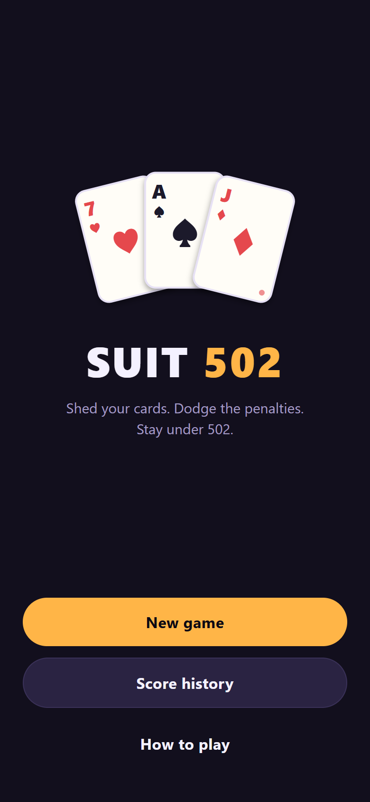
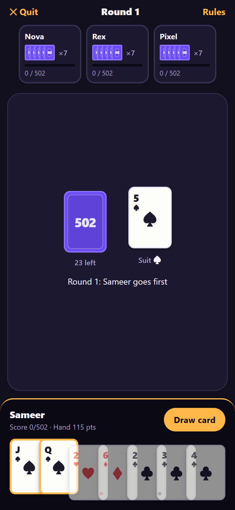
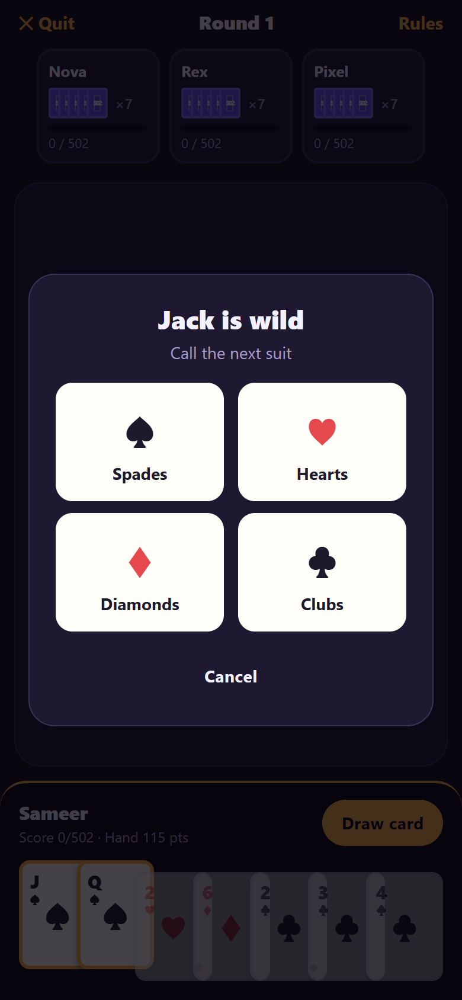
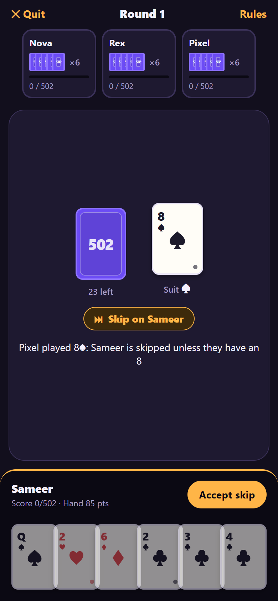
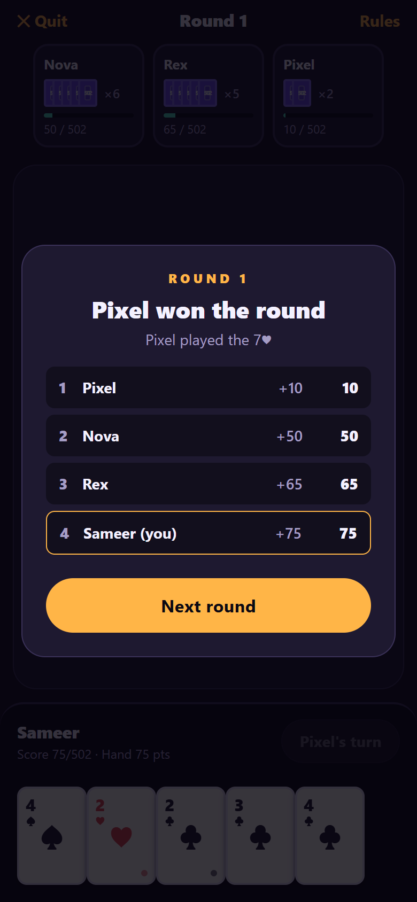
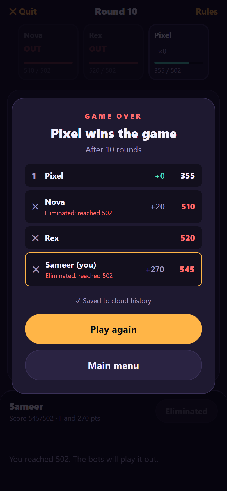
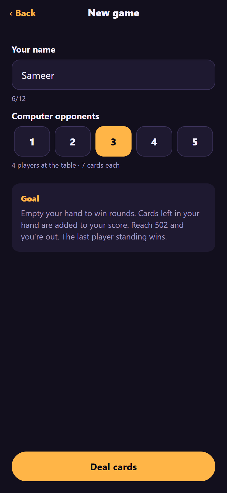
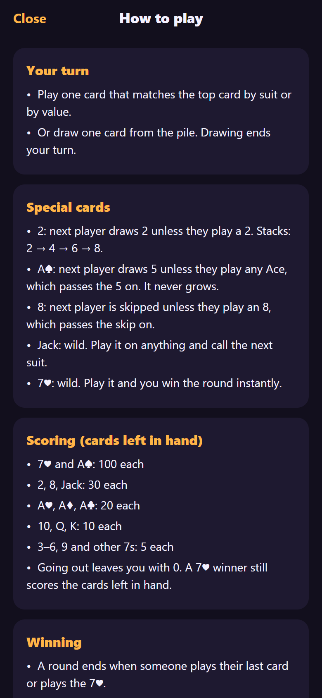

# Suit 502

A mobile version of the card game **502** built with React Native and Expo. You play against 1–5 computer opponents.

## Run it

```bash
npm install
npx expo start
```

Scan the QR code with **Expo Go** on your phone. The phone and computer must be on the same Wi-Fi.

## How the game works

- Each player gets 7 cards. On your turn, play a card that matches the top card's suit or value, or draw one card.
- **2**: next player draws 2 unless they play a 2. It stacks: 2 → 4 → 6 → 8.
- **A♠**: next player draws 5 unless they play any Ace, which passes the 5 on.
- **8**: next player is skipped unless they play an 8.
- **Jack**: wild. You choose the next suit.
- **7♥**: wild. Playing it wins the round instantly.
- Cards left in your hand at the end of a round become points. Reach **502** and you are out. The last player standing wins.
- Going out on a 2 or A♠ still makes the next player take the penalty. A 7♥ winner still scores the cards left in hand.
- Whoever scored the fewest points in a round starts the next one.

## Project structure

```
src/
  app/            Screens (Expo Router: every file is a screen)
    _layout.js    Stack navigator
    index.js      Home
    setup.js      Name + number of opponents
    game.js       The game table
    history.js    Past games (bonus)
    rules.js      How to play
  game/           Game logic (no UI code)
    deck.js       Cards, deck, shuffle
    rules.js      Card points, which cards can be played
    engine.js     Game state + reducer (all moves)
    ai.js         Computer opponent
  components/     Reusable UI pieces
  firebase/       Firebase setup
  services/       Saving and loading score history
scripts/
  simulate.mjs    Plays hundreds of bot games to test the rules
```

## Score history (bonus)

Finished games are saved to **Firebase Firestore** in the `gameHistory` collection, and the **Score history** screen lists them with wins, win rate and best score.

- Config: `src/firebase/firebaseConfig.js`
- Saving and loading: `src/services/historyService.js`
- Security rules: `firestore.rules` (allow reading and adding results; block edits and deletes)
- Connection test: `npm run test:firebase`

If Firebase can't be reached (for example, no internet), the result is saved on the device with AsyncStorage and still shows on the history screen.

## Packages

- `expo-router`: screen navigation
- `react-native-reanimated`: animations
- `firebase`: Firestore score history
- `@react-native-async-storage/async-storage`: offline history fallback

## Test the game logic

```bash
npm run simulate
```

## Gameplay video

[Watch the gameplay recording](demo/suit502-gameplay.mp4): a full game against 3 bots, from setup to game over, then the score history.

## Screenshots

| Home | Game table | Jack: pick a suit |
|---|---|---|
|  |  |  |
| **Skip penalty** | **Round summary** | **Game over** |
|  |  |  |
| **New game** | **How to play** | **Score history** |
|  |  |  |
